# DroneRL

DroneRL is a learning project in which a quadcopter learns to choose its own flight path with reinforcement learning. It reaches a goal while avoiding obstacles using only basic sensors and a single RGB camera, with no 360° lidar. Training happens in simulation first, and the target is a real drone. The main purpose of the project is hands-on practice with RL and ML, from writing DQN and PPO from scratch to sim2sim transfer with PX4 and Gazebo.

<p align="center">
  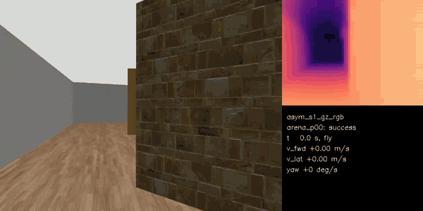
  <br>
  <em>A student policy flying from the RGB camera in Gazebo with PX4 SITL. Left: the onboard camera. Right: depth predicted from that image by the depth network, which is the only thing the policy sees besides the drone state.</em>
</p>

## Current status

| Milestone | Topic | Status |
|---|---|---|
| M0 | RL fundamentals: DQN and PPO written from scratch, compared with Stable-Baselines3 | done |
| M1 | Drone in a full physics simulator (gym-pybullet-drones) | done |
| M2 | Navigation among obstacles, teacher policy with privileged lidar in a GPU environment | done |
| M3 | Depth perception from RGB and a student policy that sees only the camera | done |
| M4 | ROS 2 + PX4 SITL + Gazebo, sim2sim evaluation | **done, latest stage** |
| M5 | Hardware: build, PX4 configuration, onboard computer, system identification | next |
| M6 | Sim2real: autonomous flights on the real drone | planned |

**Where the project is now:** the whole flight stack (camera, depth network, policy, safety filter, PX4 offboard control) runs in ROS 2 against PX4 SITL in Gazebo. The students reach 76.7 ± 4.7% success (mean of 3 seeds) from the RGB camera alone (96.7% in an open arena, 81.7% in a corridor, 51.7% in a dense room). The M4 success criterion (at least 70% in every world) is met in the arena, the closest match to the planned real-world test, and in the corridor, but not in the dense room. The next step is either another iteration in simulation or moving on to hardware (M5).

**Where the project is heading:** M5 brings the same ROS 2 graph onto a Raspberry Pi 5 with a Hailo-8 NPU, an IMX477 camera and a MicoAir H743 flight controller running PX4. M6 is the final goal: at least 7 of 10 autonomous flights through a 10 m arena with 3-5 obstacles without pilot intervention. The hardware architecture is described in [docs/drone_architecture.md](docs/drone_architecture.md).

## Results at a glance

| Stage | Setting | Key result |
|---|---|---|
| M0 | Gymnasium | Own PPO on LunarLander continuous: 277.3 ± 1.8 vs SB3 275.7 ± 2.8, 3.5x faster wall time |
| M1 | gym-pybullet-drones, reach a goal | Velocity actions: 100% success, robust to +20% mass, delay and wind. Motor-speed actions: 91%, collapse to 1% with +20% mass |
| M2 | GPU navigation env, privileged lidar | Teacher (curriculum): 99.5 / 99.3 / 97.5% success on easy / medium / hard test maps (A* with the full map: 100%) |
| M3 | Same env, depth image only | Best student (PPO with asymmetric critic): 94.0% on medium, 97% of the teacher |
| M4 | ROS 2 + PX4 SITL + Gazebo, RGB camera | 76.7 ± 4.7% over 3 seeds and 180 flights (arena 96.7, corridor 81.7, room 51.7) |

All success rates are means over 3 training seeds unless stated otherwise.

## Approach

The design follows a few decisions made at the start of the project and checked experimentally along the way.

**Hierarchical control.** The policy does not drive the motors. Every 100 ms (10 Hz) it outputs a velocity command in the heading frame: forward speed, lateral speed and yaw rate. PX4 keeps the drone stable and tracks that command. M1 showed why this matters: a policy on motor speeds learns quickly in simulation but falls apart as soon as the mass, delay or wind change, while the velocity policy is unaffected because the low-level controller absorbs those changes.

**Perception separated from decision making.** The camera image first goes through a monocular depth network (Depth Anything V2 Small, fine-tuned). The policy only sees a small 64×48 inverse depth image with a validity mask. This lets the policy train in a fast GPU simulator that renders depth directly, keeps the sim2real gap mostly inside the depth network, and keeps the door open for swapping the RGB camera for a depth or stereo camera later without retraining from scratch.

**Teacher and student.** A teacher policy is trained first with privileged inputs that exist only in simulation: a 72-beam 360° lidar and the exact state. A student that sees only what the real drone will see (noisy depth image, noisy state with odometry drift) is then trained by imitation (DAgger) or by PPO with an asymmetric critic that sees the privileged inputs.

**Domain randomization.** Dynamics (time constants, delays, acceleration limits), camera tilt and mounting error, depth errors modelled on the real network, state noise and odometry drift are all randomized, so the policy does not rely on any single simulator.

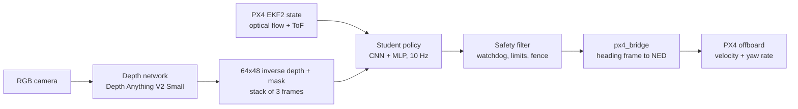

### Interface contract

One module (`dronerl/contract.py`) defines observations, actions and the reward for every simulator, the evaluation code and the ROS 2 nodes.

| Item | Definition |
|---|---|
| Control rate | 10 Hz, episodes up to 60 s, flight height 1.2 m |
| Action | `[-1, 1]^3` mapped to forward speed (up to 1.0 m/s forward, 0.3 m/s back), lateral speed (0.5 m/s) and yaw rate (60°/s) |
| Student image | 2×48×64 per frame: inverse depth (0.2-8 m) and a validity mask, 90° horizontal field of view, stack of 3 frames |
| State | 10 values: velocity in the heading frame, yaw rate, height, goal bearing (cos, sin), log goal distance, previous action |
| Teacher extras | 72-beam lidar and clean state, simulation only |
| Reward | progress toward the goal + 10 on success - 10 on collision - 0.01 per step - 0.05·‖Δa‖² - 0.1·proximity to obstacles |

## Technologies

| Area | Tools |
|---|---|
| Language and tooling | Python 3.12, uv, ruff, pytest (148 tests) |
| Deep learning | PyTorch, TensorBoard, Hugging Face Transformers |
| RL libraries (baselines) | Gymnasium, Stable-Baselines3, rsl_rl |
| RL algorithms written in this repo | DQN (with Double DQN), PPO, GPU-vectorized PPO, PPO with asymmetric critic, DAgger |
| Simulators | gym-pybullet-drones (M1), own GPU-vectorized navigation environment in PyTorch (M2-M3), Gazebo Harmonic with PX4 SITL (M4) |
| Hyperparameter search | Optuna (TPE sampler, median pruner) |
| Perception | Depth Anything V2 Small (metric indoor), NYU Depth v2, ONNX and ONNX Runtime (CUDA) |
| Robotics stack | ROS 2 Jazzy, PX4 v1.17, Micro XRCE-DDS, rosbag2 (MCAP), Docker with the NVIDIA container toolkit |
| Development machine | single RTX 4060 (8 GB), 20 CPU threads, 31 GB RAM |

## Stages and conclusions

### M0: RL fundamentals

DQN and PPO were written from scratch and compared with Stable-Baselines3 on CartPole, LunarLander (continuous) and Pendulum, followed by ablations of the main design choices: target network, Double DQN, GAE λ, observation normalization and bootstrapping on truncation.

| Environment | Own implementation | Stable-Baselines3 |
|---|---|---|
| CartPole-v1, DQN | 500 / 500 / 500 | 500 / 500 / 500 |
| LunarLander-v3 continuous, PPO (1M steps) | 277.3 ± 1.8 (3.8 min) | 275.7 ± 2.8 (13.4 min) |
| Pendulum-v1, PPO | -261 ± 154 (one seed collapsed) | -169.7 ± 4.0 (gSDE) |

<p align="center">
  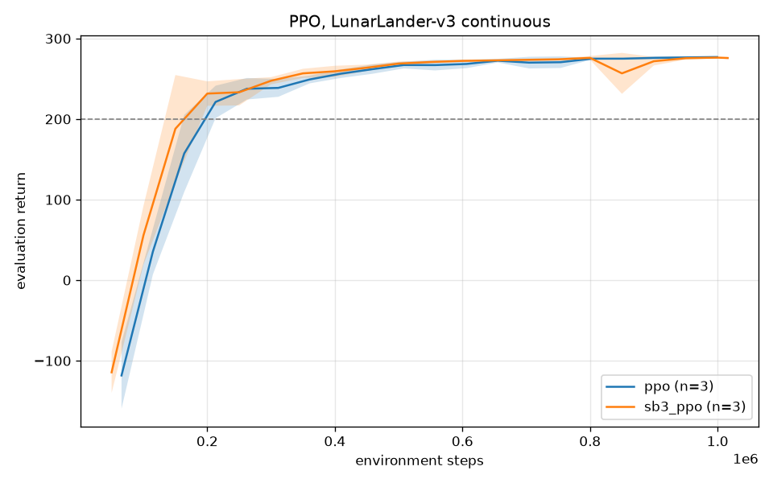
  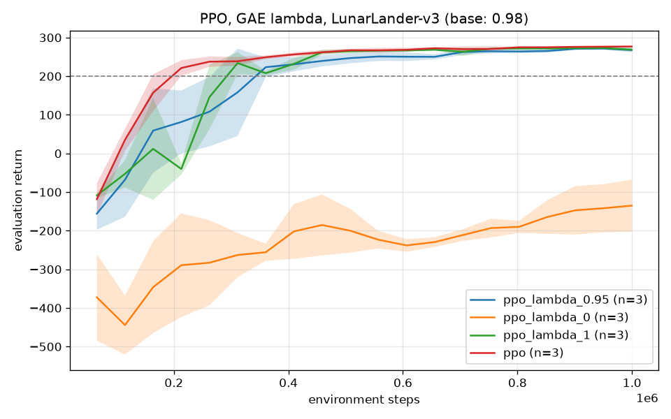
</p>

**Conclusions**
- The own PPO matches SB3 in sample efficiency and is 3.5x faster in wall time, so it became the base for all later stages.
- GAE λ matters a lot: λ = 0 (pure one-step TD) does not learn LunarLander at all within 1M steps, while 0.95-0.98 works best.
- Without a target network DQN training is unstable. Double DQN reduces the overestimation of Q-values, but on CartPole the effect is small.
- One Pendulum seed got stuck because the policy's exploration noise collapsed (std 0.02). SB3 with state-dependent exploration (gSDE) did not have this problem. This was a useful lesson about entropy and exploration in PPO.

### M1: Drone in a full physics simulator

A `GoalReach` task in gym-pybullet-drones: fly from a random start to a random goal in 3D. Experiments compared the action space (velocity commands vs direct motor speeds), PPO vs SAC, and reward shaping (dense, sparse, potential-based), followed by a robustness test.

<p align="center">
  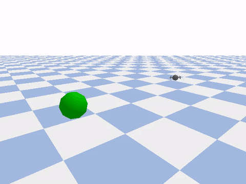
</p>

| Experiment | Result |
|---|---|
| Velocity vs motor speeds (PPO) | 100% vs 91 ± 4% success |
| Own PPO vs SB3 PPO | both 100%, same number of steps |
| PPO vs SAC | SAC needs 3-4x fewer environment steps but about 8x more wall time on CPU |
| Dense vs sparse reward | sparse: 88 ± 17%, about 6x slower, one seed never learned |
| Robustness: +20% mass / 2-step delay / wind | velocity policy 100 / 100 / 100%, motor-speed policy 1 / 20 / 35% |

<p align="center">
  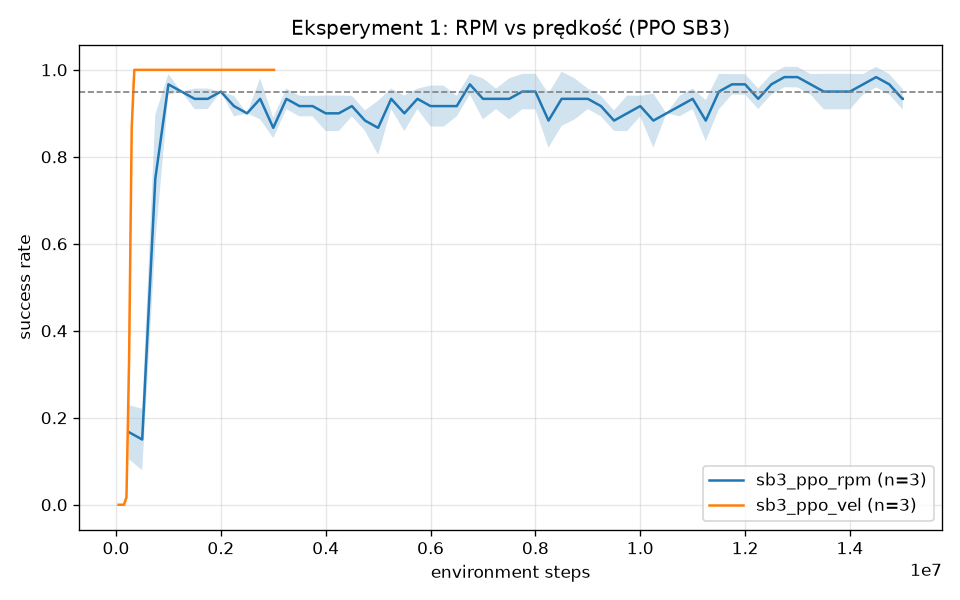
  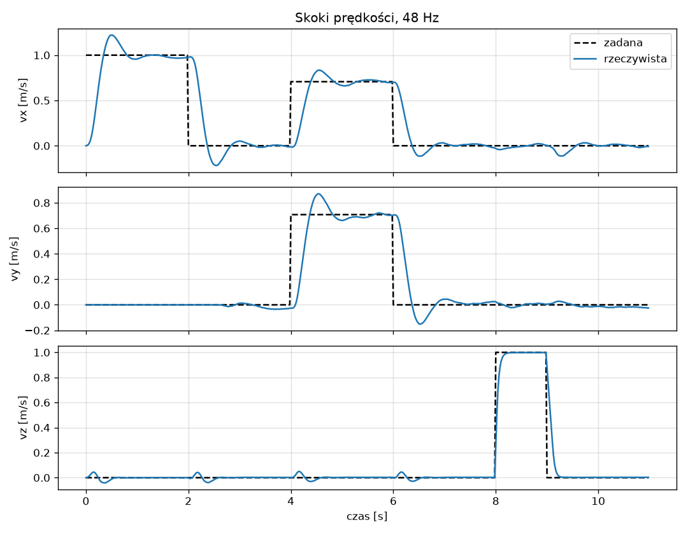
</p>

**Conclusions**
- The robustness test is the strongest argument for hierarchical control: the velocity controller absorbs changes in mass, delay and wind, so the policy does not have to. This fixed the architecture for the rest of the project: RL sets velocities, PX4 stabilizes.
- The cost is agility: the velocity loop has a time constant of about 0.3 s and about 20% overshoot.
- Sparse rewards work, but much more slowly and less reliably. Potential-based shaping learns as fast as the dense reward.
- With a shaped reward a higher return does not mean a better policy: selecting checkpoints by return picked slower policies. From then on checkpoints are selected by success rate.

### M2: Navigation among obstacles, teacher policy

M2 introduced the main training environment: a fully GPU-vectorized navigation simulator written in PyTorch (`dronerl/envs/nav_gpu.py`). It has first-order velocity dynamics with delay, ray-cast depth images and lidar, collision checks and automatic resets, and runs at **140k steps/s with 4096 parallel environments** on a single RTX 4060. Maps are generated procedurally: rooms and corridors with circles, boxes and thin walls at six density levels, with 4096 training maps and separate validation and test maps per level.

<p align="center">
  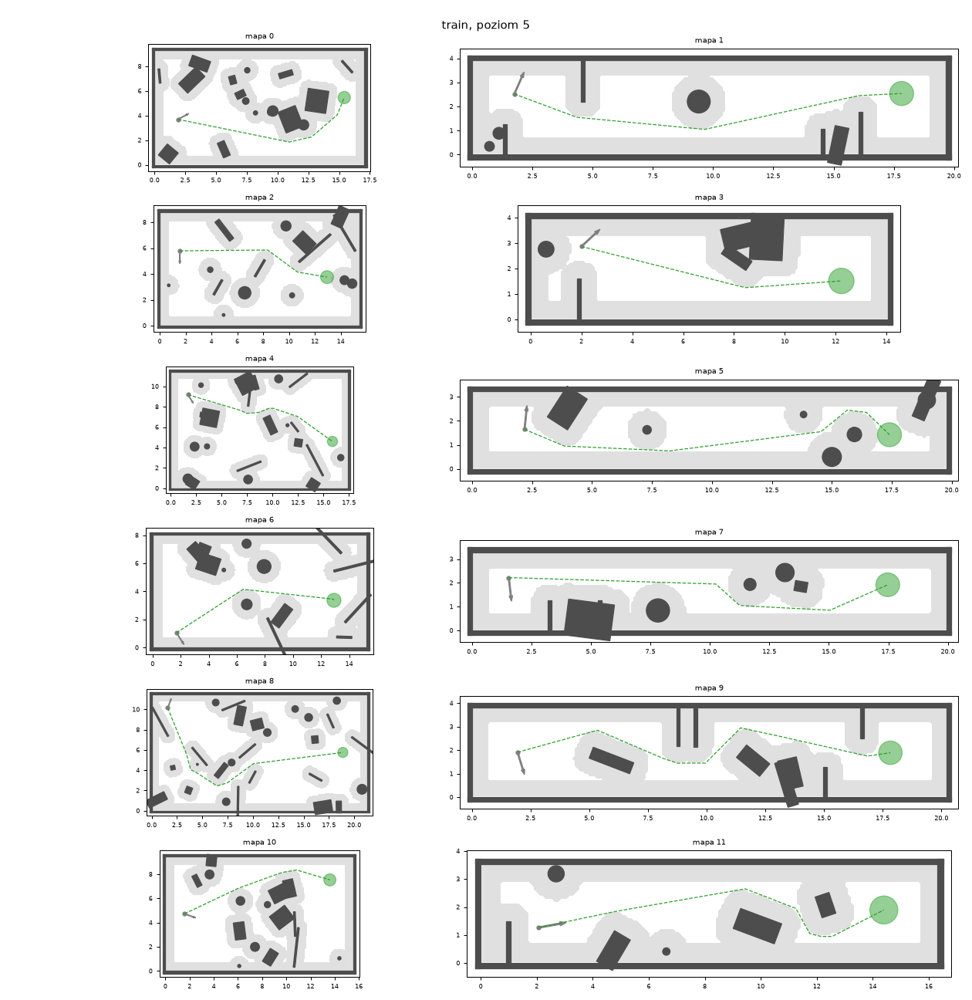
  <br>
  <em>Training maps at the hardest level. Grey halo: collision margin around obstacles. Green dashed line: A* path to the goal (green circle).</em>
</p>

The teacher is a PPO policy trained with the own GPU PPO: a CNN encodes the depth image and an MLP combines it with the lidar and the state. Experiments:

| Experiment | Result (test success, easy / medium / hard) |
|---|---|
| A* + pure pursuit with the full map (reference) | 100 / 100 / 100% |
| Own GPU PPO vs rsl_rl (same encoder) | within 1.2 percentage points |
| Curriculum vs no curriculum (100M steps) | 99.5 / 99.3 / 97.5% vs 99.5 / 98.0 / 96.8% |
| Optuna config (31 trials, 4M-step budget) trained to 150M steps | 98.7 / 95.2 / 94.7% |
| Curriculum + dynamics randomization, nominal / randomized dynamics | 99.8 / 96.8 / 97.3% and 99.2 / 96.2 / 96.8% |

<p align="center">
  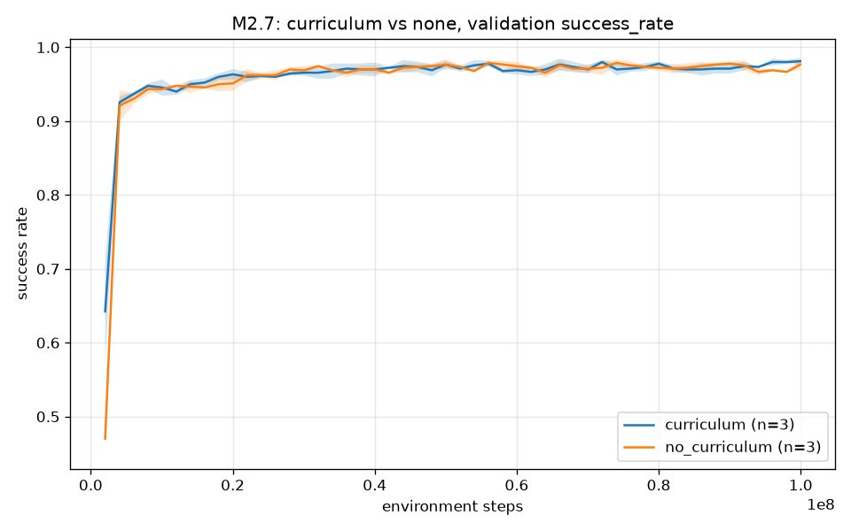
  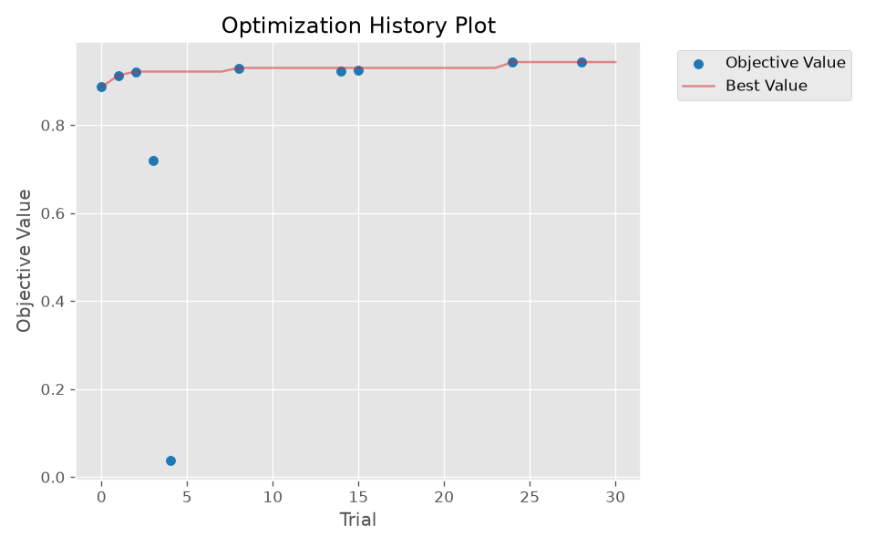
</p>

<p align="center">
  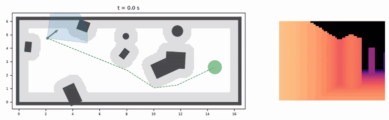
  <br>
  <em>Teacher policy on a medium test map. Blue: flown path, dashed green: A* reference, blue fan: camera field of view. Right: the depth image the policy receives.</em>
</p>

<p align="center">
  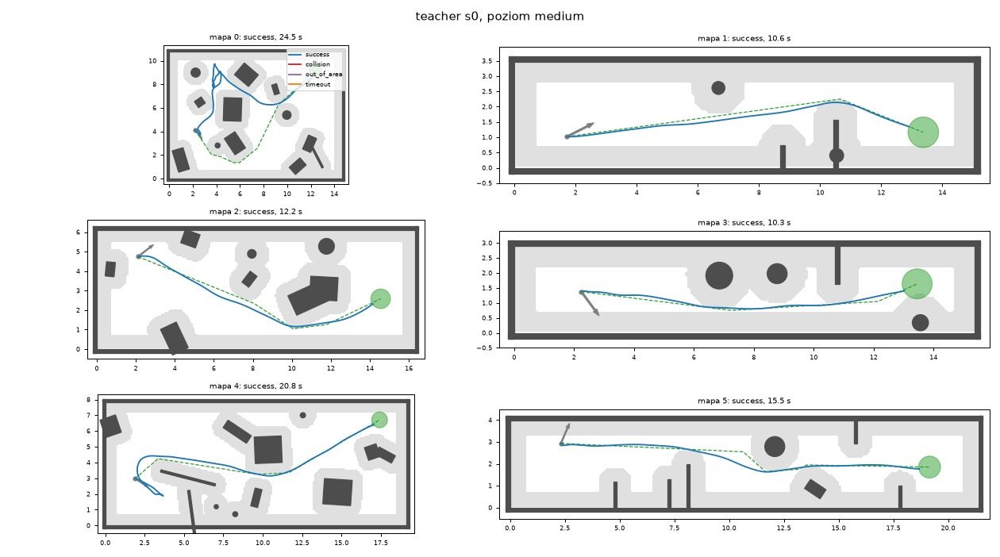
</p>

**Conclusions**
- The GPU simulator was the key enabler: 100M steps take about 80 minutes, so every experiment could be run with 3 seeds.
- At this scale curriculum learning is not necessary, but it starts faster and never hurts.
- **Optuna lesson:** with a short trial budget (4M steps) the search picked a configuration that learns quickly at the start but ends worse after 150M steps (more aggressive updates, smaller distance from obstacles). The hand-tuned curriculum configuration won on every level. The search budget biases what "best" means.
- Dynamics randomization costs almost nothing under nominal dynamics and makes the teacher much more robust: it loses 0.5 percentage points under random dynamics instead of 4-6.5. This teacher was used for M3.
- Typical teacher failures: narrow passages, thin walls seen at a sharp angle, and dead ends (the policy has no memory).

### M3: Depth perception and student policy

**Depth network.** Depth Anything V2 Small (metric indoor) was evaluated on NYU Depth v2 and fine-tuned. The input resolution (518) was chosen because smaller inputs break the metric scale even when the shape of the depth map stays good.

| Variant (NYU test) | AbsRel | δ1 |
|---|---|---|
| zero-shot | 0.218 | 0.669 |
| fine-tuned, frozen encoder | 0.138 ± 0.011 | 0.845 ± 0.018 |
| fine-tuned, full network | **0.126 ± 0.014** | **0.879 ± 0.017** |

**Depth error model.** Running the depth network inside the RL simulator is too slow, so the policy trains on ray-cast depth with a noise model fitted to the real errors of the network: a per-frame scale error drawn from empirical quantiles, range-dependent residuals, heavier errors near edges and spatially correlated noise. A second, parametric profile imitates an active depth camera (holes, range limits). Training uses a 70/30 mix of the two profiles. The simulator also models camera tilt from acceleration, mounting error, vibration, image delay, state noise and odometry drift, while still running at 30k steps/s.

<p align="center">
  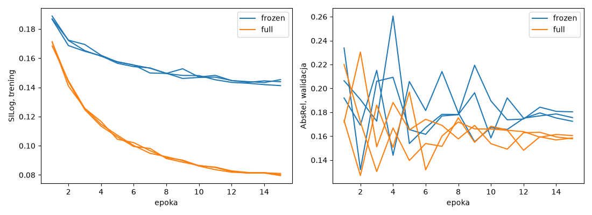
  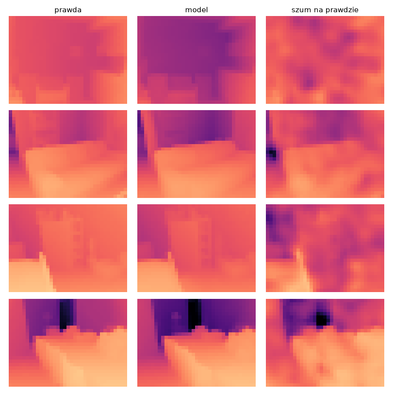
  <br>
  <em>Left: training loss and validation AbsRel during fine-tuning. Right: ground truth depth, the network's prediction and the noise model applied to the ground truth, all at the 64×48 policy resolution.</em>
</p>

**Student training.** Students see only the noisy depth image and the noisy state. Variants trained by DAgger from the M2 teacher were compared with PPO using an asymmetric critic (the actor sees the student inputs, the critic sees privileged ones).

| Student | Test medium | Test hard | With depth-camera noise | Of teacher |
|---|---|---|---|---|
| DAgger, 3-frame stack (main) | 89.2 ± 2.1 | 86.7 ± 0.8 | 86.2 ± 2.7 | 92.4% |
| DAgger, no history | 85.5 ± 1.1 | 85.0 ± 2.4 | 85.5 ± 0.4 | 88.6% |
| DAgger, GRU memory | 93.5 ± 1.9 | 92.8 ± 1.2 | 91.8 ± 1.2 | 96.9% |
| DAgger, trained without noise | 84.8 ± 1.3 | 81.7 ± 2.0 | 36.2 ± 14.3 | 87.9% |
| DAgger, monocular noise only | 90.5 ± 2.3 | 86.5 ± 0.0 | 49.8 ± 7.8 | 93.8% |
| **PPO with asymmetric critic** | **94.0 ± 2.0** | **94.0 ± 0.8** | **96.2 ± 0.2** | **97.4%** |

<p align="center">
  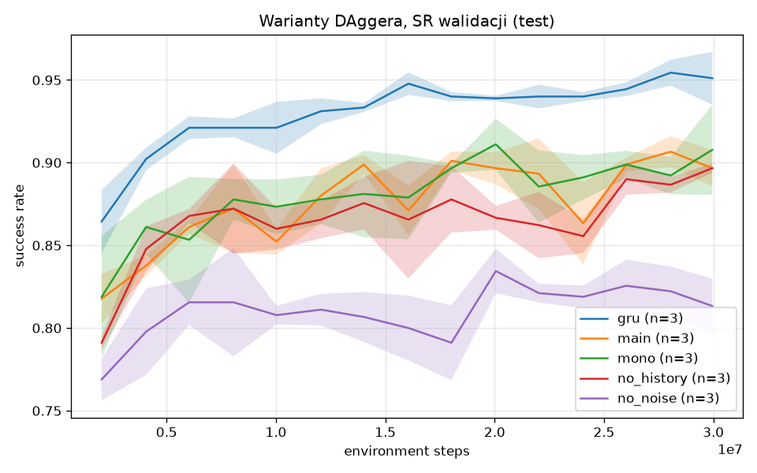
  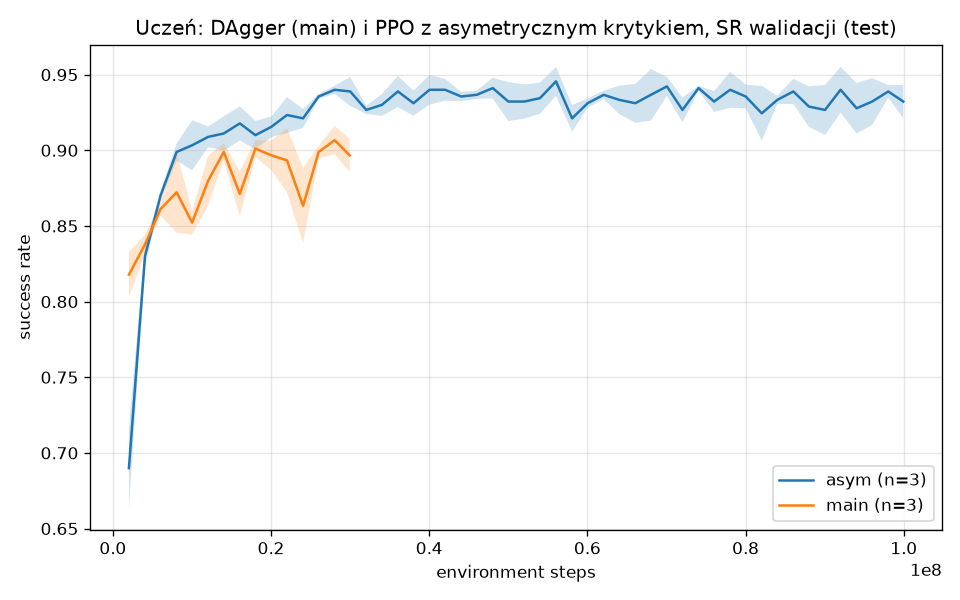
</p>

<p align="center">
  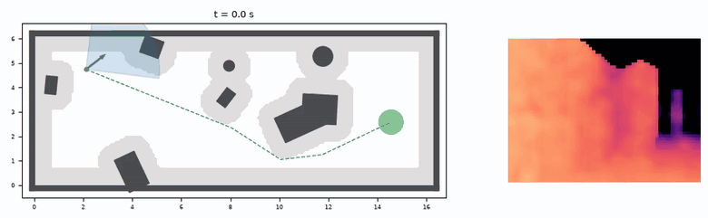
  <br>
  <em>DAgger student on the same map as the teacher above. The depth image on the right is noisy and blurred, as it will be from a real monocular depth network.</em>
</p>

**Conclusions**
- Memory helps: no history 85.5%, 3 stacked frames 89.2%, GRU 93.5%.
- Training noise is essential. Without it the student is the best on clean depth but collapses to 36% with depth-camera errors. Mixing the monocular and depth-camera profiles costs nothing for the RGB camera and keeps a later switch to a depth or stereo camera open.
- PPO with an asymmetric critic beats DAgger: DAgger imitates a teacher with a 360° lidar and also learns decisions that cannot be made from a 90° camera alone (an information gap), while PPO optimizes the reward under the student's own observations. The price is less smooth control.
- Remaining failures: cutting corners in corridors, thin obstacles that are only a few pixels wide at 64×48, hesitation in clutter, and circling near the goal caused by odometry drift.

### M4: ROS 2 + PX4 SITL + Gazebo (sim2sim)

M4 moved the student into a completely different simulator with a real autopilot. Everything runs in one Docker image: ROS 2 Jazzy, Gazebo Harmonic, PX4 v1.17 SITL and the Micro XRCE-DDS agent, with the depth network on the GPU through ONNX Runtime.

- **Drone model:** an X500 with an RGB camera (640×480, 30 Hz), plus a downward optical flow camera and ToF rangefinder. No GPS: PX4 EKF2 estimates position from flow and range, as indoors on the real drone.
- **Worlds:** M2 maps exported to Gazebo with textures (`arena`: a hand-made 10×10 m room, `corridor`, `room`), 20 start-goal pairs each. Gazebo geometry agrees with the training simulator on 99% of depth pixels.
- **ROS 2 nodes:** `depth_node`, `policy_node`, `safety_node`, `px4_bridge` (the only node that writes to PX4), `mission_node`, `monitor_node`, all started from one launch file and recorded to rosbag.
- **Safety tests (all pass):** killing the policy node (zero command after 0.35 s, landing after 1.1 s), loss of offboard control, the safety-filter fence, the PX4 hard geofence and pilot takeover.
- **System identification:** step responses of PX4 showed a 0.26 s delay that was outside the training range, so the delay randomization was widened to 0-0.3 s.
- **Latency:** camera frame to PX4 setpoint p95 about 96-101 ms, close to the 100 ms budget, dominated by the depth network.

<p align="center">
  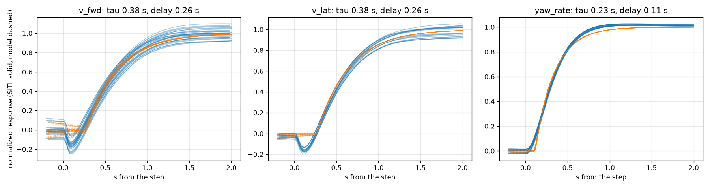
  <br>
  <em>System identification: PX4 SITL velocity and yaw-rate step responses (blue) against the fitted first-order-with-delay model used in training (orange).</em>
</p>

<p align="center">
  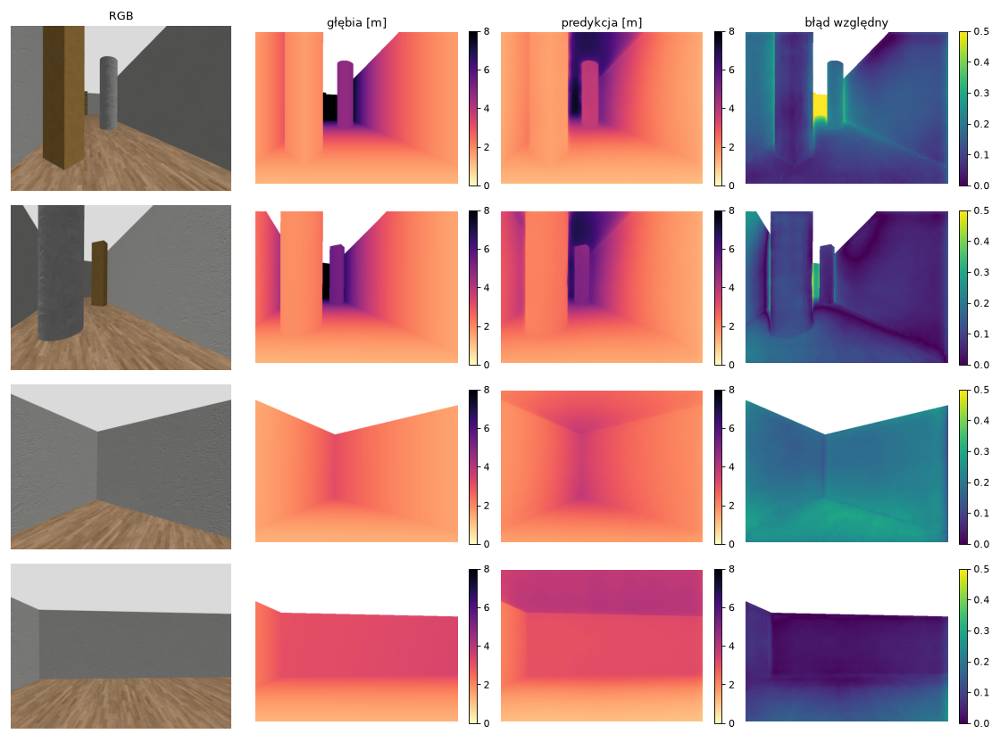
  <br>
  <em>The fine-tuned depth network on Gazebo frames: RGB, true depth, prediction and relative error (AbsRel 0.213, much better than 0.321 zero-shot).</em>
</p>

**First sim2sim round (360 flights).** The M3 students reached 67.2 ± 7.5% from RGB. Splitting the gap for seed 0 showed about +9 percentage points from dynamics (the same policy with true depth in Gazebo) and +23 from perception (true depth replaced by the depth network).

**Closing the gap.** Replaying Gazebo conditions inside the training simulator found two causes. First, the bridge rotated the command into the world frame immediately, while training rotated it after the delay, which gives up to 15° of direction error when turning. Second, the EKF frame in SITL rotates by a few degrees, which shifts the goal by about 10% of the distance flown. The fixes were a heading prediction in `px4_bridge`, larger odometry drift in training, a third depth-noise profile fitted to the network's errors on Gazebo frames, and 40M steps of PPO fine-tuning. A* with the new bridge went from 80% to 97%.

| Series (gz_rgb, 20 flights per world) | Arena | Corridor | Room | All |
|---|---|---|---|---|
| A* + pure pursuit with the full map | 100 | 100 | 90 | 97 |
| Student seed 0 | 95 | 75 | 40 | 70 |
| Student seed 1 | 100 | 80 | 60 | 80 |
| Student seed 2 | 95 | 90 | 55 | 80 |
| **Mean of 3 seeds after gap closing** | **96.7 ± 2.4** | **81.7 ± 6.2** | **51.7 ± 8.5** | **76.7 ± 4.7** |
| Mean of 3 seeds before gap closing | 91.7 | 73.3 | 36.7 | 67.2 ± 7.5 |

<p align="center">
  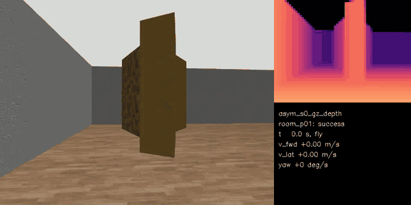
  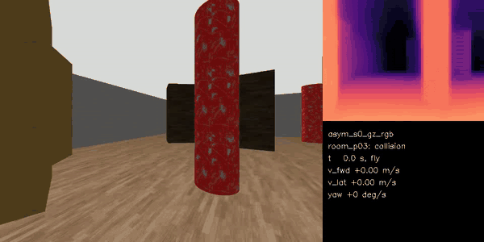
  <br>
  <em>First sim2sim round. Left: a successful flight through the dense room with true depth from Gazebo. Right: a collision in the room when depth comes from the RGB network.</em>
</p>

<p align="center">
  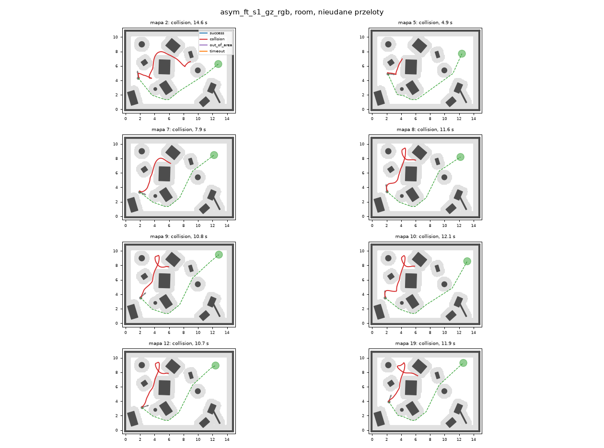
  <br>
  <em>Failed flights of one student in the room world after gap closing. Red: flown path, dashed green: A* reference.</em>
</p>

**Conclusions**
- A sim2sim step is worth doing before hardware: it found a frame-ordering bug in the bridge and an estimator effect that would have been much harder to diagnose on a real drone.
- Measure, then randomize: system identification found a delay outside the training range, and the depth errors on new images had a different structure than on NYU.
- The arena, which is the closest to the planned real test, is solved at 95-100%. In the corridor, collisions happen with a wall seen at a sharp angle at the end of the corridor, a perception gap. The dense room is already limited by the policy itself (71-86% even in the training simulator) and by perception on top of that.
- A policy trained only in a cheap simulator with modelled noise transferred to PX4, Gazebo and a real depth network, losing about 14 percentage points against the same start-goal pairs in the training simulator.

## Next steps

1. **Decide on M4 follow-up:** either move to hardware now (the arena meets the criterion) or do one more simulation round, such as fine-tuning on depth produced by the network from Gazebo frames instead of modelled noise, or improving the policy in dense rooms.
2. **M5, hardware bring-up:** Raspberry Pi 5 with a Hailo-8 NPU (AI HAT+, 26 TOPS), Sony IMX477 camera with a wide lens, MicoAir H743 v2 flight controller with PX4, MicoAir 4-in-1 ESC, MicoAir MTF-02 optical flow and ToF sensor. Steps: PX4 configuration and manual flights, offboard control through the same `px4_bridge`, system identification from flight logs, and the depth network compiled for the Hailo-8, which is the main technical risk. Details: [docs/drone_architecture.md](docs/drone_architecture.md).
3. **M6, sim2real:** fine-tune the student with the dynamics, delays and depth errors measured on the real drone, then a ladder of tests: replaying recorded data through the pipeline, props-off tests, hover, flights without obstacles, then with obstacles, then at full speed.

## Repository layout

```
dronerl/
  contract.py      observation, action and reward definitions shared by everything
  agents/          DQN, PPO, GPU PPO, PPO with asymmetric critic, student networks
  envs/            GoalReach (pybullet), GPU navigation env, maps and A*, ray casting, depth noise
  perception/      NYU data, depth fine-tuning, metrics, noise model fitting
  train/           configs per milestone, DAgger, Optuna, multi-seed runner, SB3 and rsl_rl baselines
  eval/            evaluation, plots, robustness, system identification, sim2sim metrics
  runtime/         frame conversions, observation stacking and safety logic used by ROS 2 nodes
deploy/            ONNX export of the depth network and the student
docker/            image with ROS 2, Gazebo, PX4 SITL build tools and ONNX Runtime
ros2_ws/           ROS 2 package dronerl_ros: nodes and launch file
sim/               Gazebo models and worlds, PX4 parameters, flight scripts for M4
tests/             unit and integration tests
plan/, PLAN.md     project plan and detailed milestone plans (in Polish)
docs/              hardware architecture and README media
```

## Getting started

```bash
uv sync                      # Python environment
uv run pytest                # tests
uv run python -m dronerl.agents.ppo_gpu --config dronerl/train/configs/m2/ppo_gpu_teacher_rand.yaml --seed 0
```

The M4 stack runs in Docker. PX4 v1.17.0 and px4_msgs are expected in `external/` (see `plan/M4.md`):

```bash
docker build -f docker/Dockerfile -t dronerl-m4 .
HEADLESS=1 docker/run.sh docker/smoke_test.sh   # PX4 SITL + Gazebo + ROS 2 smoke test
HEADLESS=1 docker/run.sh sim/test_flight.sh     # one full flight with the whole chain
```

Training outputs, checkpoints and videos go to `runs/`, which is not tracked in git.
