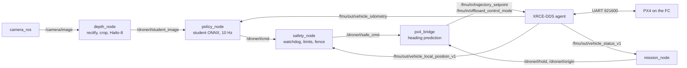

# DroneRL drone architecture

Hardware and software architecture of the real drone for M5 and M6. It is the target design, nothing of it is built yet. It replaces the Jetson + Pixhawk variant from `PLAN.md` (section 3.3) with the parts at hand: Raspberry Pi 5 with the AI HAT+ (26 TOPS), MicoAir H743 v2, MicoAir 4in1 ESC, MicoAir MTF-02 and an IMX477 camera.

## 1. Principle

The drone runs the same chain as the Gazebo flights of M4. The companion computer decides where to fly, the flight controller keeps the drone in the air.

| | Raspberry Pi 5 + AI HAT+ | MicoAir H743 v2 with PX4 |
|---|---|---|
| Job | perception and decision | stabilisation, state estimation, safety |
| Runs | camera -> depth network (Hailo-8) -> student policy (CPU) -> safety filter -> velocity command | EKF2 (IMU, optical flow, rangefinder), velocity and attitude controllers, mixer, failsafes |
| Rate | camera 30 Hz, commands 10 Hz | controllers at several hundred Hz, DShot to the ESC |
| If it fails | PX4 sees the offboard stream stop and lands or hands the drone to the pilot (tested in SITL, M4.8) | pilot with the RC kill switch |

The Pi never drives the motors. It sends the command of the contract, `(v_fwd, v_lat, yaw_rate)` in the heading frame, which `px4_bridge` turns into a PX4 velocity setpoint at a fixed height of 1.2 m.

## 2. Components

| Part | Role | Notes |
|---|---|---|
| Raspberry Pi 5 | companion computer | active cooler under the HAT, own 5 V / 5 A supply |
| AI HAT+ 26 TOPS (Hailo-8) | depth network | PCIe, HailoRT |
| IMX477 (HQ camera) | front RGB camera | needs a wide lens, see section 5 |
| MicoAir H743 v2 | flight controller | STM32H743, BMI088 + BMI270, SPL06 baro, QMC5883L compass, 8 UARTs, no CAN, BEC 5 V / 3 A and 12 V / 3 A |
| MicoAir 4in1 ESC | motors | DShot600; PX4 has no bidirectional DShot on this board |
| MicoAir MTF-02 | optical flow + ToF rangefinder | flow FOV 42°, up to 7 m/s at 1 m, ToF 2 cm-2.5 m, UART 115200, MAVLink, 4.5 g, needs > 60 lx |
| ELRS receiver | RC link | arm/kill and Position <-> Offboard switches |
| 5 V / 5 A BEC | Pi supply | the 5 V BEC of the FC is too weak for the Pi with the HAT |
| Frame, motors, props, battery | | the companion stack adds roughly 150-200 g, keep thrust to weight ≥ 2 |

## 3. Wiring

```
 Battery ── MicoAir 4in1 ESC ── M1..M4
    │          └─ ESC connector (VBAT, GND, current, DShot) ──┐
    └── BEC 5 V / 5 A ───────────────────────┐                │
                                             v                v
 ┌───────────────────────┐ TELEM1 921600 ┌──────────────────────────────┐
 │ Raspberry Pi 5        │<─────────────>│ MicoAir H743 v2, PX4 v1.17.0 │
 │ GPIO14/15, GND        │  uXRCE-DDS    │ TELEM3 <- MTF-02 (MAVLink)   │
 │ CSI   <- IMX477       │               │ RC     <- ELRS (CRSF)        │
 │ PCIe  <- AI HAT+      │               │ TELEM4 = onboard Bluetooth   │
 │ Wi-Fi -> ground laptop│               │ TELEM2 spare                 │
 └───────────────────────┘               │ 5 V BEC -> ELRS, MTF-02      │
                                         └──────────────────────────────┘
```

Flight controller ports (UART names from MicoAir, PX4 names from `boards/micoair/h743-v2`):

| UART | PX4 port | Device | Protocol |
|---|---|---|---|
| UART1 | TELEM1 (`/dev/ttyS0`) | Raspberry Pi 5 | uXRCE-DDS, 921600 |
| UART5 | TELEM3 (`/dev/ttyS4`) | MTF-02 | MAVLink, 115200 |
| UART6 | RC (`/dev/ttyS5`) | ELRS receiver | CRSF |
| UART8 | TELEM4 (`/dev/ttyS7`) | onboard Bluetooth | MAVLink to QGroundControl on the bench |
| UART4 | TELEM2 (`/dev/ttyS3`) | spare | e.g. MAVLink to the Pi for QGroundControl over Wi-Fi |

Raspberry Pi 5 header:

| Pin | Signal | To |
|---|---|---|
| 8 | GPIO14 TXD | FC UART1 RX |
| 10 | GPIO15 RXD | FC UART1 TX |
| 6 | GND | FC GND |
| 2, 4 / 6 | 5 V / GND | 5 V / 5 A BEC (or USB-C) |

- Pi and FC have separate BECs and a common ground. Only TX, RX and GND run between them, both sides use 3.3 V logic.
- UART, not USB: uXRCE-DDS over the USB port of this board has been reported not to work.
- FC on soft mounts. Camera rigid to the frame, facing forward, with a measured pitch (training randomises a mount error of up to ±5°). MTF-02 under the frame, facing down with a clear view.

## 4. Flight controller

### 4.1 Firmware

PX4 v1.17.0, target `micoair_h743-v2_default`, built from `external/PX4-Autopilot` (`make micoair_h743-v2_default`) and flashed in QGroundControl as a custom firmware file. The version must match SITL and the `px4_msgs` of the onboard container, otherwise the DDS messages do not match. The target of v1.17.0 has the uXRCE-DDS client, DShot, optical flow and distance sensor support enabled.

### 4.2 Parameters

Start from `sim/px4/dronerl.params` (EKF2 with flow and rangefinder and no GPS, offboard loss, geofence) and add:

```
# link to the Pi
MAV_0_CONFIG    0        # TELEM1 runs MAVLink by default
UXRCE_DDS_CFG   101      # TELEM1
SER_TEL1_BAUD   921600
# MTF-02 on TELEM3
MAV_1_CONFIG    103      # TELEM3
MAV_1_MODE      0        # Normal
SER_TEL3_BAUD   115200
EKF2_OF_CTRL    1
EKF2_HGT_REF    2        # height from the rangefinder, EKF2_RNG_CTRL as in dronerl.params
SENS_FLOW_ROT   0        # check: turning the drone by hand must not show a velocity
EKF2_OF_POS_X/Y/Z, EKF2_RNG_POS_X/Y/Z    # measured on the frame
GF_MAX_VER_DIST 2.0      # the MTF-02 measures up to about 2.5 m
```

In QGroundControl: DShot600 for the motor group in Actuators, rotor geometry of the frame, battery cells, accelerometer, gyro and RC calibration, RC switches for arm/kill and Position <-> Offboard, RC required (`COM_RC_IN_MODE`), offboard loss to Position (`COM_OBL_RC_ACT`), a shorter `COM_OF_LOSS_T` than 1 s, RC loss to Land. Attitude tuning with the autotune module after the first manual flights.

### 4.3 MTF-02

Before wiring it, set its output to MAVLink for PX4 in MicoAssistant. Check the flow orientation with the drone in hand and the height against a tape measure.

### 4.4 Open decisions

- Compass: the onboard QMC5883L can be unreliable indoors next to power wires. In SITL the EKF2 frame turned by 6-7° (up to 25°), which moves the goal of the student. The navigation is relative to the start, so an absolute heading is not needed; flying without a compass has to be tried.
- Barometer: off in SITL because it drifted; on the real drone decide from logs.

## 5. Camera

| Item | Setting | Why |
|---|---|---|
| Lens | focal length about 2.2-2.7 mm, about 110-120° horizontal | the sensor is about 6.29 × 4.71 mm; 100° after rectification needs f ≈ 2.64 mm, and the student sees the central 90° (73.7° vertical at 4:3). A 6 mm lens gives only about 55° |
| Sensor mode | 2028 × 1520, 2×2 binning, full field of view, 30 fps, scaled to 640 × 480 | 4:3 like the contract image, same input size as in Gazebo |
| Exposure | manual, about 5 ms | at 60°/s of yaw the blur stays around 2 px |
| Focus | set to infinity and locked | |
| Calibration | ChArUco or checkerboard, OpenCV fisheye model, a remap table on the Pi | the 90° crop is computed from the calibrated focal length, as `crop` is for the Gazebo camera |
| Timestamps | sensor timestamps from libcamera | `depth_node` carries the stamp of the source frame through the chain, which gives the frame -> command latency |

## 6. Raspberry Pi 5

### 6.1 Host

- Raspberry Pi OS 64-bit (Bookworm): official support of the Pi 5 camera stack and of the AI HAT+.
- `raspi-config`: no login shell on the serial port, hardware UART on (`/dev/ttyAMA0`). Camera auto detection on (`camera_auto_detect=1`).
- `sudo rpi-eeprom-config --edit`: `PSU_MAX_CURRENT=5000`, the Pi is not on the official supply.
- `sudo apt install hailo-all` (PCIe driver and HailoRT), Docker.

### 6.2 Onboard container `dronerl-onboard` (arm64)

A separate image from `docker/Dockerfile`, without Gazebo and the PX4 build:

- ROS 2 Jazzy, `px4_msgs` v1.17.0, Micro XRCE-DDS Agent v2.4.3 (`MicroXRCEAgent serial --dev /dev/ttyAMA0 -b 921600`),
- `camera_ros` on the Raspberry Pi fork of libcamera (with the imx477 tuning file), OpenCV,
- HailoRT of the same version as the host driver, ONNX Runtime on the CPU for the student,
- `dronerl` (contract, `runtime/`) and the `dronerl_ros` nodes, rosbag2 with mcap,
- devices: `/dev/ttyAMA0`, `/dev/hailo0`, the camera devices.

### 6.3 ROS 2 graph



`real.launch.py` (to write in M5) starts the agent, the camera, the nodes and the recording. On the real drone `mission_node` does not arm or take off: the pilot takes off in Position and the policy flies only while the RC switch is on Offboard; leaving Offboard hands the drone back to the pilot. `monitor_node` judged the flights from the Gazebo ground truth, here only the recording stays.

## 7. Data flow and latency

| Step | Where | Time |
|---|---|---|
| frame at 30 Hz, rectification, 90° crop | Pi CPU | about 5 ms |
| depth network | Hailo-8 | target ≤ 50 ms |
| reduction to 64 × 48, stack of 3 frames, student | Pi CPU | a few ms |
| safety filter, bridge, UART to PX4 | Pi CPU, UART | about 1-2 ms |
| PX4 answer to a velocity setpoint | FC | 0.26 s in SITL, to be identified on the drone (`lead` of `px4_bridge`) |

Target: frame -> setpoint ≤ 100 ms at the 95th percentile, as in M4 (`PLAN.md` M5 asks for ≤ 150 ms).

## 8. Depth network on the Hailo-8

The depth model of M3 (Depth Anything V2 Small fine-tuned on NYU, input 518) took about 420 ms per frame on 12 PC threads, so the CPU of the Pi is far too slow for 10 Hz and the RGB variant needs the HAT. The official Hailo Model Zoo has no Depth Anything (only fast_depth and scdepthv3), so the model is compiled here:

1. Fine-tune the model at a lower input, e.g. 252 × 336 (multiples of 14, 4:3). The student sees only 64 × 48; in M3 the metric scale suffered at low resolution without fine-tuning.
2. Quantise to int8 and compile with the Hailo Dataflow Compiler on the PC, calibrating on NYU, Gazebo and real camera frames.
3. Measure on the Pi, target ≤ 50 ms per frame.
4. Fit a depth noise profile to the quantised model on real frames with reference depth and fine-tune the student on it, as for the Gazebo profile in M4.12.

Fallbacks: scdepthv3 from the Model Zoo fine-tuned for metric depth, or a depth camera instead of the IMX477 (the student already trains with the `active` noise profile).

## 9. Safety layers

| Layer | Where | Trigger | Action |
|---|---|---|---|
| Watchdog | `safety_node` | no command for 0.3 s | zero command, PX4 holds the position |
| Policy timeout | `mission_node` | no command for 1 s | Land |
| Limits and fence | `safety_node` | command over the contract limits, height outside 0.5-2 m, edge of the flight area | clipped command, zero command out of the heights, speed towards an edge limited (margin 1.1 m) |
| Offboard loss | PX4 | setpoint stream stops (`COM_OF_LOSS_T`) | Position with RC, else Land |
| Geofence | PX4 | cylinder around home, ceiling (`GF_*`) | Hold, Land after 5 s |
| Pilot | RC | Offboard switch off | Position mode, no return to Offboard |
| Kill switch | RC | switch | motors off |

## 10. Simulation counterpart

| Item | SITL (M4) | Real drone | Change in the simulation |
|---|---|---|---|
| Rangefinder | LW20-like ToF | MTF-02, up to 2.5 m | limit the range to 2.5 m |
| Optical flow | flow camera of the model | MTF-02, FOV 42° | flow FOV 42° |
| RGB camera | 640 × 480, 100°, no distortion | IMX477 with a wide lens, rectified | intrinsics from the calibration |
| PX4 answer | 0.26 s (M4.9) | to identify from ulog | `RANGES` and `lead` from the identification |
| State estimate | EKF2 of SITL | EKF2 with MTF-02 | `DRIFT` and state noise from flight logs |

## 11. Training impact

The contract stays, so nothing is trained from scratch. Estimates from the runs of M3 and M4 on the RTX 4060:

| Step | Machine time |
|---|---|
| depth model fine-tuning at the lower input | 0.5-1 h |
| int8 quantisation and Hailo compilation | 1-3 h per variant |
| depth noise profile of the quantised model | minutes |
| student fine-tuning (PPO asym, 40M steps, 3 seeds) | about 3 h |
| second round after the identification of the real drone, if needed | 0-3 h |
| check in Gazebo (gz_rgb, 3 seeds), optional | about 2.5 h of flights |

## 12. Bring-up order

1. FC, ESC and RC: motor order and directions, manual flights, autotune.
2. MTF-02: 60 s hover in Position with a drift below 0.3 m.
3. Pi and FC over uXRCE-DDS: offboard square through `px4_bridge`, no network.
4. Camera calibration, depth network on the Hailo-8, latency measurement.
5. System identification from ulog, update of the simulation.
6. Student fine-tuning, then policy flights in a net with the pilot on the switch.

## 13. Risks

- Compiling the fine-tuned Depth Anything for the Hailo-8, and its accuracy after int8 quantisation.
- Reference depth on real frames for the noise profile.
- The 2.5 m range of the MTF-02 on dark floors, and the light it and the camera need.
- Heading source indoors (compass or none).
- Mass and supply of the companion stack, heat of the Pi with the HAT in a closed frame.

## References

- [MicoAir743v2](https://micoair.com/flightcontroller_micoair743v2/)
- [MicoAir MTF-02](https://micoair.com/optical_range_sensor_mtf-02/)
- [PX4 uXRCE-DDS](https://docs.px4.io/v1.17/uk/middleware/uxrce_dds.html)
- [Raspberry Pi AI HAT+](https://raspberrypi.com/documentation/computers/ai.html)
- [Hailo Model Zoo, depth estimation](https://github.com/hailo-ai/hailo_model_zoo/blob/master/docs/public_models/HAILO8/HAILO8_depth_estimation.rst)
- [Depth Anything V2 ViT-S on Hailo-8 (Seeed)](https://sensecraft.seeed.cc/ai-lab/en/models/depth_anything_v2_vits)
